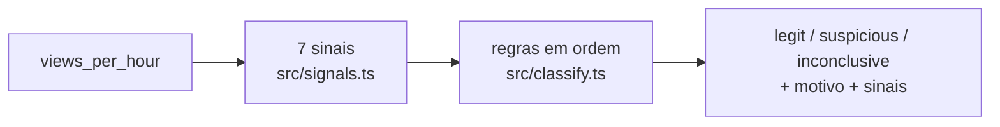

# Conty. Views que não parecem humanas

API que recebe a série de views por hora de um vídeo e diz se ela parece tráfego real. A resposta traz a classificação (`legit`, `suspicious` ou `inconclusive`), um motivo em português com os números que decidiram e todos os sinais medidos. O critério é um conjunto de regras explícitas. Não há modelo opaco.

## Como rodar

Node 22 ou mais novo.

```bash
npm install
npm test
npm run typecheck
npm run dataset
npm start
```

| Comando | O que faz |
| --- | --- |
| `npm start` | Sobe a API em `http://127.0.0.1:3009`. `PORT` muda a porta (veja `.env.example`). |
| `npm run dataset` | Gera o dataset sintético em `dataset/views.json`, classifica cada série e imprime a matriz de confusão e a taxa de falso positivo. |
| `npm test` | Roda os testes, inclusive o que compara a taxa deste README com a medida. |

A API não guarda estado e não usa banco. A mesma série devolve sempre a mesma resposta.

## Modelo



Cada sinal é uma função pura que lê a série e devolve `{ name, value, threshold, fired, explanation }`. Uma tabela de regras em ordem olha quais sinais dispararam. A primeira regra que casa decide a classificação e monta o motivo.

## Endpoints

| Método e caminho | Corpo | Sucesso |
| --- | --- | --- |
| `POST /classify` | `{ "views_per_hour": [195, 219, 185, ...] }` | 200 |

`views_per_hour` é a lista de views de cada hora, em ordem, a primeira hora primeiro. A resposta:

```json
{
  "classification": "suspicious",
  "reason": "Suspeito: o pico tem forma de tráfego comprado, que entra de uma vez, fica parado no topo e sai de uma vez. O maior valor (3.204 views na hora 17) é 15,8 vezes a mediana da série (203 views por hora). ...",
  "signals": [
    {
      "name": "flat_top",
      "value": 6,
      "threshold": 3,
      "fired": true,
      "explanation": "O topo ficou 6 horas seguidas acima de 95% do máximo (3.044 views). Platô conta a partir de 3 horas."
    }
  ]
}
```

`signals` traz os 7 sinais, inclusive os que não dispararam. Um sinal que não se aplica à série vem com `value: null` e diz por quê. As horas no texto contam a partir de 1.

Os erros têm a forma `{ "error": "mensagem", "code": "codigo" }` e são checados nesta ordem:

```text
422 invalid_body       corpo não é um objeto JSON
422 views_required     views_per_hour ausente, vazio ou não é lista
422 series_too_long    mais de 2.160 horas (90 dias)
422 views_invalid      algum valor não é inteiro maior ou igual a zero; a mensagem diz qual hora
```

[`EXEMPLOS.md`](EXEMPLOS.md) traz cada caso com curl e a resposta real.

## Critério

### Sinais

| Sinal | O que mede | Dispara quando |
| --- | --- | --- |
| `spike` | Maior valor dividido pela mediana da série. | 5 vezes ou mais. |
| `step_rise` | Maior alta em uma hora antes do pico, como fração do caminho da mediana até o pico. | 80% ou mais. Só com pico. |
| `flat_top` | Horas seguidas acima de 95% do máximo. | 3 horas ou mais. Só com pico. |
| `cliff` | Maior queda em uma hora depois do pico, como fração da altura do pico. | 60% ou mais. Só com pico. |
| `too_smooth` | Variação típica de uma hora para a outra dividida pela raiz da mediana. | 50% ou menos. |
| `exact_repetition` | Fração das horas que repetem exatamente o valor de k horas antes (k de 1 a 24). Só conta horas com 10 views ou mais. | 50% ou mais. |
| `drop_to_zero` | Média das 6 horas seguintes dividida pela média das 6 anteriores, no pior ponto da série. Só conta trechos com média de 30 ou mais. | 5% ou menos. |

O porquê de `too_smooth`: views reais chegam uma a uma, por acaso, como ligações numa central. Com média de m views por hora, só esse acaso já faz o número oscilar perto de raiz de m. Mil views por hora oscilam perto de 32. Um robô que entrega 1.000 por hora com variação de 3 é liso demais para ser gente. O limite começou em 30% e subiu para 50% depois da primeira medição. Com 30%, cinco robôs de platô do dataset ficavam logo acima do limite. Nenhuma série orgânica do dataset chega perto de 50%.

### Regra de combinação

As regras ficam numa tabela só, `RULES` em `src/classify.ts`. A primeira que casa decide.

| Ordem | Quando | Classificação |
| --- | --- | --- |
| 1 | Série com menos de 24 horas | `inconclusive` |
| 2 | `too_smooth` ou `exact_repetition` | `suspicious` (repetição mecânica) |
| 3 | `drop_to_zero` | `suspicious` (queda abrupta) |
| 4 | `spike` e pelo menos 2 de `step_rise`, `flat_top`, `cliff` | `suspicious` (pico comprado) |
| 5 | `spike` e exatamente 1 de `step_rise`, `flat_top`, `cliff` | `inconclusive` |
| 6 | `spike` sem nenhum traço de compra | `legit` (pico orgânico) |
| 7 | Nenhuma das anteriores | `legit` |

Repetição mecânica e queda abrupta acusam sozinhas porque tráfego real não produz nenhuma das duas. Um pico só acusa com dois traços de compra, porque um vídeo que estoura de verdade pode ter um deles.

### Pico orgânico contra pico comprado

O teste "os dois chegam à mesma altura, mas só o comprado é suspeito" usa a mesma linha de base de ~200 views por hora e dois picos de ~3.200:

| Sinal | Pico orgânico | Pico comprado |
| --- | --- | --- |
| Forma | sobe em 3 horas, cai pela metade a cada 6 horas | entra numa hora, fica 6 horas, sai numa hora |
| `spike` | 6,8 vezes, dispara | 15,8 vezes, dispara |
| `step_rise` | 37% | 100%, dispara |
| `flat_top` | 1 hora | 6 horas, dispara |
| `cliff` | 12% | 100%, dispara |
| Classificação | `legit` | `suspicious` |

O teste "o motivo de cada um cita os números que decidiram" confere o motivo inteiro de cada um, palavra por palavra.

### Um caso em que o classificador prefere não acusar

Um vídeo que estoura numa hora só, porque foi compartilhado por uma conta grande, sobe em degrau como o comprado. Depois decai aos poucos, como o orgânico. Só `step_rise` dispara, e a regra 5 devolve `inconclusive`:

> Inconclusivo: o pico tem um traço de compra, mas o resto da forma é de pico orgânico. Um traço só não basta para acusar. O maior valor (3.204 views na hora 17) é 12,3 vezes a mediana da série (261 views por hora). Pico conta a partir de 5 vezes. A maior alta em uma hora antes do pico (de 199 para 3.204, da hora 16 para a 17) fez 100% do caminho da mediana até o pico. Degrau conta a partir de 80%.

O teste "viral que estoura numa hora só mas decai aos poucos fica inconclusivo" fixa esse caso. Uma série com menos de 24 horas também fica `inconclusive` (regra 1).

## Dataset sintético

`src/dataset.ts` gera 9 famílias de 40 séries de 72 horas, com um PRNG semeado (mulberry32, semente 20261011). Não usa `Math.random` nem rede social. A mesma semente gera sempre o mesmo arquivo, e o teste "o arquivo versionado é o que o gerador produz" confere `dataset/views.json` contra o gerador.

| Família | Rótulo | Como é gerada |
| --- | --- | --- |
| `organic_steady` | legit | Linha de base de 30 a 500 por hora, ciclo do dia leve, acaso de chegada (Poisson) e oscilação de 8%. |
| `organic_daily_cycle` | legit | Igual, com ciclo do dia forte: a madrugada cai para 15% a 50% da média do dia. |
| `organic_viral` | legit | Pico de 8 a 30 vezes a base, sobe em 2 a 5 horas, cai pela metade a cada 3 a 12 horas. |
| `organic_viral_fast` | legit | Igual, mas sobe numa hora só. É o caso difícil. |
| `bought_spike` | suspicious | Base orgânica mais um bloco de 8 a 30 vezes a base, por 3 a 8 horas, quase constante. |
| `mechanical_plateau` | suspicious | Base orgânica mais um valor fixo de 15 a 40 vezes a base, por 36 a 60 horas. |
| `mechanical_loop` | suspicious | Um padrão de 1 a 24 horas repetido exatamente. |
| `abrupt_drop` | suspicious | Tráfego alto, de 40 a 150 vezes uma base pequena, que some de uma hora para a outra entre a hora 25 e a 49. |
| `bought_drip` | suspicious | Base orgânica mais 30% a 80% de views compradas com o mesmo acaso do tráfego real. Feita para o classificador não pegar. |

### Taxa esperada de falso positivo

Falso positivo é uma série legítima classificada como `suspicious`. `inconclusive` não conta como acusação.

Taxa de falso positivo: **2 de 160 séries legítimas (1,3%)**

Saída de `npm run dataset`:

```text
Dataset: 360 séries de 72 horas, semente 20261011

                      rótulo       legit  suspicious  inconclusive
organic_steady        legit           40           0             0
organic_daily_cycle   legit           40           0             0
organic_viral         legit           40           0             0
organic_viral_fast    legit            1           2            37
bought_spike          suspicious       0          40             0
mechanical_plateau    suspicious       0          40             0
mechanical_loop       suspicious       0          40             0
abrupt_drop           suspicious       0          40             0
bought_drip           suspicious      40           0             0

Matriz de confusão (linha: rótulo do gerador; coluna: classificação)
                      rótulo       legit  suspicious  inconclusive
                      legit          121           2            37
                      suspicious      40         160             0

Taxa de falso positivo: 2 de 160 séries legítimas (1,3%)
```

Os 2 falsos positivos são virais rápidos que ficaram 3 horas perto do topo antes de decair. Um vídeo destacado numa página inicial por algumas horas faz isso. Para o classificador, ele parece um bloco comprado sem a queda em penhasco. Os 40 de `bought_drip` passam como `legit`: é o que o critério não detecta.

O teste "a taxa de falso positivo do README é a que o comando mede" gera o dataset em memória, mede a taxa e compara com a linha em negrito acima. O teste "o README traz o relatório exato que o comando imprime" compara o bloco inteiro. Se o critério ou o gerador mudar e este README não, os dois falham.

## O que ele não detecta

- Compra diluída: views compradas espalhadas ao longo de dias, com o mesmo acaso do tráfego real. É a família `bought_drip`, e nenhuma das 40 é pega.
- Robô que imita a curva orgânica: sobe em horas, decai devagar e varia como gente.
- Compra pequena: um pico comprado menor que 5 vezes a mediana não conta como pico.
- Compra que dura a série inteira com ruído de verdade: sem pico, sem queda e sem lisura, ela vira a linha de base.
- Vídeo tirado do ar ou tornado privado: a queda para zero é real, e o classificador acusa `drop_to_zero` do mesmo jeito.
- Qualquer coisa fora da série de views: retenção, curtidas, origem do tráfego, país.

## Onde está cada regra

```text
src/
├── app.ts          # rota POST /classify e validação da entrada
├── signals.ts      # SIGNALS: os 7 sinais, cada um uma função pura com seu limite
├── classify.ts     # RULES: a regra de combinação, em ordem, e o motivo de cada uma
├── dataset.ts      # gerador semeado, famílias, medição e relatório
├── dataset-cli.ts  # npm run dataset: grava dataset/views.json e imprime o relatório
└── index.ts        # sobe o servidor
dataset/views.json  # dataset versionado
test/classificador.test.ts
test/dataset.test.ts
```

## O que ficou de fora

- Banco, autenticação e interface. A API só classifica a série recebida.
- Horário de início da série (`started_at`). Nenhum sinal depende da hora do dia, então o campo não mudaria a resposta.
- Dados de rede social real, como pede o enunciado.

## Com mais tempo

- Medir a taxa numa semente separada, além da semente do README. O limite de `too_smooth` foi ajustado olhando esta semente, então a taxa daqui tende a ser otimista.
- Calibrar os limites com séries reais rotuladas por quem decide renovação.
- Usar o horário de início para comparar cada hora com a mesma hora de outros dias. Isso pegaria compra que respeita o ciclo do dia.

## Uso de IA

- Feito com IA (Claude Code): o critério e os sinais, a regra de combinação, o gerador do dataset e as famílias, o código, os testes, a execução com curl de `EXEMPLOS.md` e este README. Na revisão, a IA achou e corrigiu três pontos. O motivo dizia "fez 102% do caminho" quando o degrau começava abaixo da mediana, e o teste "viral que estoura numa hora só mas decai aos poucos fica inconclusivo" fixa o texto com 100%. O exemplo de queda abrupta dos testes era, sem querer, um robô constante, e a lisura disparava junto. A primeira medição deixava passar cinco robôs de platô, e o limite de `too_smooth` subiu de 30% para 50%, como explicado em Critério.
- Revisado por mim: PENDENTE
